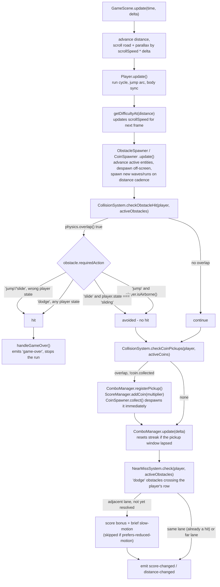

# Collision Flow

This is what `GameScene.update()` does every frame, in order. It's the one
diagram worth reading alongside the actual source
([`GameScene.ts`](../../src/game/scenes/GameScene.ts)) since the order
matters: an obstacle hit returns early and skips everything after it.



## Why the avoidance rule is a single function

Every obstacle's avoidance behavior reduces to one check in
`CollisionSystem.checkObstacleHit()`:

```ts
const avoided =
  (obstacle.requiredAction === 'jump' && player.isAirborne()) ||
  (obstacle.requiredAction === 'slide' && player.state === 'sliding')
```

`'dodge'` obstacles have no corresponding clause, so they always count as a
hit on overlap - the only way to avoid one is to not be in its lane, which
the physics overlap check already handles for free (a different-lane
obstacle simply never overlaps the player's body). This is also why the
near-miss and collision systems can share the same `requiredAction` field
instead of needing separate obstacle categorization.
