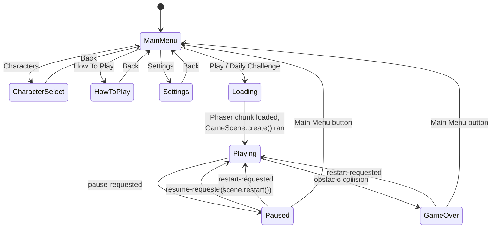

# Game State Machine

This covers the top-level screen/run state (owned by `App.tsx`'s `screen`
state plus `GameScene`'s internal `isGameOver`/pause flags). It's a separate
concern from the player entity's own state machine
(`running` / `jumping` / `sliding` / `dead`), which is documented in
[GAMEPLAY_SYSTEMS.md](../GAMEPLAY_SYSTEMS.md).

## Why pause/resume/restart are commands, not screens

`Paused` and `GameOver` are not separate React screens - the `playing`
screen stays mounted (so the `GameCanvas` and its Phaser instance never
unmount and remount), and `PauseScreen`/`GameOverScreen` are overlays drawn
conditionally based on events `useGameEvents` has received from
`EventBus`. The actual pause/resume/restart _behavior_ lives entirely in
`GameScene`:

- `pause-requested` → `GameScene.requestPause()` → `this.scene.pause()`
- `resume-requested` → `GameScene.requestResume()` → `this.scene.resume()`
- `restart-requested` → `this.scene.restart()`, which re-runs `create()`

A paused Phaser scene stops calling `update()` entirely, which is what
actually freezes gameplay - there's no separate "is the game logically
paused" flag that every system has to remember to check.
