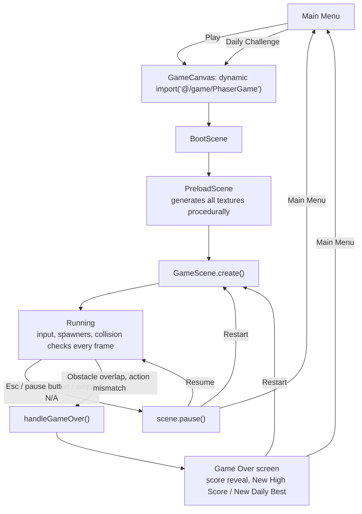

# Gameplay Flow

## Notes on this flow

- **The loading step is real, not decorative.** Phaser is lazy-loaded only
  when a run actually starts (see
  [TECHNICAL_DECISIONS.md](../TECHNICAL_DECISIONS.md)), so there is a brief
  "Loading run..." state between pressing Play and the canvas existing.
- **Restart re-enters at `Create`, not `Boot`.** `scene.restart()` tears down
  and re-runs `GameScene.create()` directly; Boot/Preload only run once per
  page load, since the generated textures don't change between runs.
- **Game over is driven entirely by `GameScene`**, not by the UI. The scene
  decides a run has ended (an unavoidable obstacle overlap), updates the
  registry if a new best was set, and emits a single `game-over` event with
  everything the UI needs (score, distance, coins, which kind of best was
  beaten, and the recorded ghost events if this is the new endless best).
  `App.tsx`'s listener is what actually writes that into `localStorage` -
  GameScene never touches storage directly.
