# System Architecture

```mermaid
graph TB
    subgraph React["React UI layer (always mounted)"]
        App["App.tsx<br/>screen state, save data, settings"]
        MainMenu
        CharacterSelect
        Settings
        HowToPlay
        PlayScreen
        GameHUD
        PauseScreen
        GameOverScreen
        TouchControls
    end

    subgraph Phaser["Phaser game layer (lazy-loaded on Play)"]
        PhaserGame["PhaserGame.ts<br/>factory + registry handoff"]
        BootScene --> PreloadScene --> GameScene
        GameScene --> Player
        GameScene --> LaneController
        GameScene --> InputManager
        GameScene --> ObstacleSpawner
        GameScene --> CoinSpawner
        GameScene --> CollisionSystem
        GameScene --> DifficultyManager
        GameScene --> ScoreManager
        GameScene --> ComboManager
        GameScene --> NearMissSystem
        GameScene --> ParallaxBackground
        GameScene --> ReplayRecorder
        GameScene --> GhostRunner
    end

    EventBus[("EventBus<br/>hand-rolled, no Phaser dependency")]
    Storage[("services/storage.ts<br/>versioned localStorage")]
    Audio["AudioManager<br/>Web Audio API"]

    App -- "dynamic import() on mount" --> PhaserGame
    PhaserGame -- "registry: characterId, mode, highScore,<br/>dailyBest, ghostEvents" --> GameScene
    GameScene -- "emits facts: score-changed,<br/>coins-changed, game-over, ..." --> EventBus
    EventBus -- notifies --> GameHUD
    EventBus -- notifies --> PauseScreen
    EventBus -- notifies --> GameOverScreen
    GameHUD -- "pause-requested" --> EventBus
    TouchControls -- "touch-move-left/right,<br/>touch-jump, touch-slide" --> EventBus
    EventBus -- commands --> GameScene
    App -- "read/write save data" --> Storage
    GameScene -- "playJump/playCoin/..." --> Audio
    App -- "setVolumes on settings change" --> Audio
```

## Layer responsibilities

**React** owns every screen the player isn't actively running through: the main
menu, character select, settings, how-to-play, and all the overlay chrome
(HUD, pause, game over) drawn on top of the game canvas. It also owns all
persisted state - `useSaveData` and `usePersistentState` are the only things
that read or write `localStorage`.

**Phaser** owns the actual run: the scrolling world, the player's physics
body, obstacle/coin spawning, collision resolution, and the gameplay-side
half of scoring, combo, difficulty, and near-miss logic. It is deliberately
kept out of the React tree - `GameCanvas.tsx` mounts a single `Phaser.Game`
into a plain `
` and never re-renders it.

**EventBus** is the only channel between the two. It carries facts one way
(Phaser → React: score changed, coins changed, game over, ...) and commands
the other way (React → Phaser: pause requested, restart requested, a touch
button was tapped). Neither side holds a direct reference to the other's
internals. EventBus is a small hand-rolled emitter rather than
`Phaser.Events.EventEmitter`, specifically so that importing it from React
code never pulls the Phaser package into the eagerly-loaded bundle - see
[TECHNICAL_DECISIONS.md](../TECHNICAL_DECISIONS.md) for why that mattered.

**AudioManager** is a third shared singleton, used by both layers for the
same reason EventBus is: a button click sound in React and a jump sound in
Phaser both need the same `AudioContext` and the same volume/mute state.

## Data handoff at scene start

React can't pass props directly into a Phaser scene, so `PhaserGame.ts`
writes the run's initial state into `game.registry` (Phaser's own
cross-`Game`-instance key/value store) before the first scene boots:
`highScore`, `characterId`, `mode`, `dailyBest`, and `ghostEvents`.
`GameScene.create()` reads all of them back out on every run, including
after a `scene.restart()` - the registry persists for the lifetime of the
`Phaser.Game` instance, not just one scene's lifetime, so a mid-session
restart still compares against the score that was just set.
